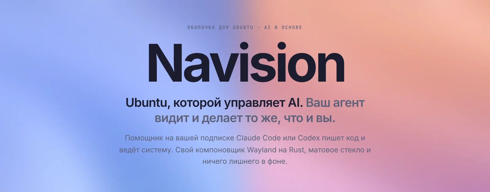
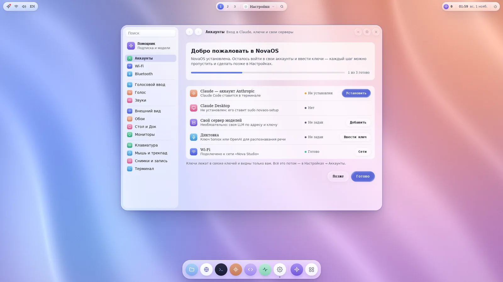
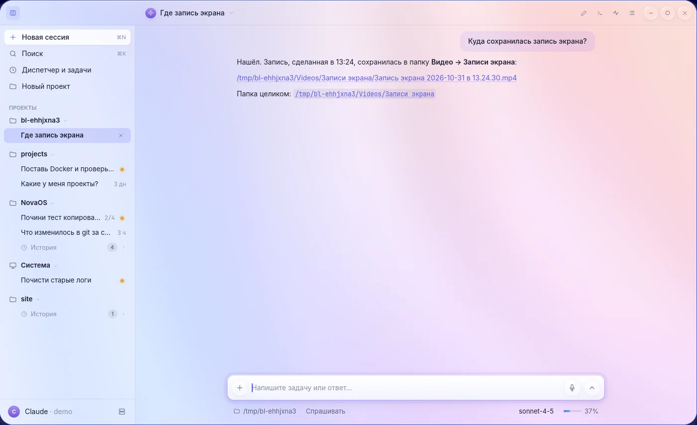

<picture>
  <source media="(prefers-color-scheme: dark)" srcset="shots/banner-dark.webp">
  
</picture>

**[Navision website](https://snemesh.github.io/navision/)** · [Install on Ubuntu](#install-on-ubuntu) · [Remote Navision for Mac](#remote-navision-for-mac) · [All builds](https://github.com/snemesh/navision/releases) · [Українською](#українською) · [Po slovensky](#po-slovensky)

> **Beta 1, the first public beta.** Some things may not work yet. If something breaks,
> [tell us in issues](https://github.com/snemesh/navision/issues).

Navision is a desktop for Ubuntu with its own Wayland compositor. An assistant on your own
Claude Code or Codex subscription writes code and runs the system: "install Docker", "what
is loading the server", "fix the test". This repository holds the website and ready builds.
CI builds them from changes that passed every check.

<picture>
  <source media="(prefers-color-scheme: dark)" srcset="shots/desk-dark.webp">
  
</picture>

## Install on Ubuntu

Ubuntu Server or Desktop **26.04, x86_64**, with an AMD, Intel or NVIDIA graphics card. One
command in a terminal:

```sh
curl -fsSL https://github.com/snemesh/navision/releases/download/latest-main/install.sh | sh
```

It asks for your `sudo` password. The installer looks at the machine and sets up:

- the Ubuntu packages that are missing (PipeWire, Xwayland, portals, fonts…);
- the NVIDIA driver and `nvidia-drm.modeset=1` on NVIDIA machines (`--no-gpu-driver` leaves them alone);
- Navision itself in `/usr/lib/novaos` and its services;
- sign-in: its own login screen on Ubuntu Server, or an entry in the GDM/SDDM session list on Ubuntu Desktop;
- Google Chrome, Claude Desktop and Claude Code (`--no-extras` skips them).

At the end it tells you what to do next, usually reboot and sign in. On first sign-in
Settings → Accounts opens: that is where you sign in to Claude and enter your keys. Running
the same command again updates the system.

### Offline

On another machine download [the archive](https://github.com/snemesh/navision/releases/download/latest-main/novaos-x86_64.tar.gz)
and [install.sh](https://github.com/snemesh/navision/releases/download/latest-main/install.sh),
copy both over and run `sh install.sh --file novaos-x86_64.tar.gz`. Ubuntu packages still come
from apt.

### Uninstall

From a text console (Ctrl+Alt+F2), not from inside Navision:

```sh
sudo novaos-setup remove              # the system, its services and sign-in
sudo novaos-setup remove --packages   # and the packages the installer added
```

## Remote Navision for Mac

**[Download RemoteNavision.dmg](https://github.com/snemesh/navision/releases/download/remote-navision-latest/RemoteNavision.dmg)**
(macOS, Apple Silicon, preview)

Navision runs on an Ubuntu server without a graphics card, and your Mac draws the whole
interface: the Dock, windows, menus and animations respond instantly, even over the network.

1. Open the dmg and drag Remote Navision to Applications. The build is not notarized, so the
   first time open it with a right-click and Open. If macOS still refuses:
   `xattr -dr com.apple.quarantine "/Applications/Remote Navision.app"`.
2. Install Navision on the server with the same command as [above](#install-on-ubuntu).
3. Sign in to the server with an SSH key, no password (`ssh-copy-id user@server`), and open
   UDP ports 60100–60199 on it.

## What's inside

- **Assistant.** Claude Code in a window, not a terminal: chat with projects and history. The
  official CLI of your agent does the work: Claude Code, Codex, OpenCode, Gemini CLI.
- **Agents and root.** An agent's root command goes through a password window that shows it
  in full. Your own local LLM by address and key, jobs on a schedule.
- **Voice.** Dictation into any field, answers read aloud and conversation with the assistant.
- **Monitoring, Terminal, Files, Editor, Disks, Screenshots and screen recording.**
- **Smooth and frugal.** A frame only when something changes and on vblank; an idle desktop sleeps.
- **Apps and games.** Chrome, Claude Desktop, Steam with game mode, Wine.

The interface of Navision itself is in Russian for now; the screenshots show it as it is.



## Українською

**Beta 1, перша публічна бета.** Navision — робочий стіл для Ubuntu 26.04 (x86_64), яким
керує AI-помічник на вашій підписці Claude Code або Codex. Встановлення однією командою:

```sh
curl -fsSL https://github.com/snemesh/navision/releases/download/latest-main/install.sh | sh
```

Клієнт для Mac: [RemoteNavision.dmg](https://github.com/snemesh/navision/releases/download/remote-navision-latest/RemoteNavision.dmg).
Докладніше — на [сайті](https://snemesh.github.io/navision/?lang=uk).

## Po slovensky

**Beta 1, prvá verejná beta.** Navision je pracovné prostredie pre Ubuntu 26.04 (x86_64),
ktoré riadi AI asistent na vašom predplatnom Claude Code alebo Codex. Inštalácia jedným príkazom:

```sh
curl -fsSL https://github.com/snemesh/navision/releases/download/latest-main/install.sh | sh
```

Klient pre Mac: [RemoteNavision.dmg](https://github.com/snemesh/navision/releases/download/remote-navision-latest/RemoteNavision.dmg).
Viac na [webe](https://snemesh.github.io/navision/?lang=sk).

Found a bug? [Open an issue](https://github.com/snemesh/navision/issues).
